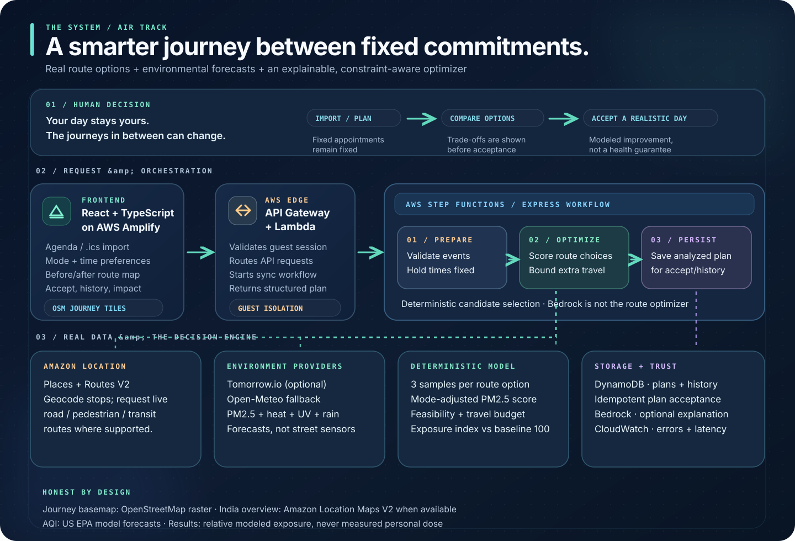

# Antelligence

**Keep the appointments. Rethink the journey between them.**

Air quality doesn't stop mattering when somebody has a class at 9, an errand at noon, and a train to catch in the evening. But an AQI number on a dashboard doesn't tell them what to change.

**Antelligence** takes the day they've already committed to and looks for better ways to travel through it. It compares routes, transport modes, and departure times against modeled air-pollution and outdoor conditions, without casually moving the things they have to show up for.

**WeMakeDevs Environmental Hacks 2026 · Air track** — [Hackathon](https://www.wemakedevs.org/aws/env) · [Rules](https://www.wemakedevs.org/aws/env/rules) · [Architecture details](docs/ARCHITECTURE.md)

[**Open the deployed app**](https://main.d22y9q2ay7ukew.amplifyapp.com/) · [**Watch the real demo**](https://youtu.be/K9sxgWoBlK0)

> **The question we're building around:** “I still need to get through my day. Which parts of the journey can I change without being late?”

## From an air-quality number to a decision

Most air-quality tools end at the map. We wanted to take the next step: make the information useful *while somebody is planning a real day*.

Imagine a student who has college in the morning and another fixed commitment later. Antelligence can check whether leaving a little earlier, taking a different supported route, or using a different verified mode has a lower **modeled exposure score**. It doesn't automatically move class, invent a metro service, or promise that changing one trip makes someone medically safer.

The output is a comparison the person can actually question: **what changes, how much time it costs, what the model estimates, and which appointments remain fixed**. If the checked options don't justify a change, the app can say that too.

## What you can do with it

1. **Bring your day.** Build a timed schedule manually or import an `.ics` calendar export. Add stops, choose your current travel modes, and optionally use browser location.
2. **Set the boundary.** Your event times stay fixed. You decide how many extra travel minutes you're willing to allow across the day.
3. **Compare real choices.** The backend checks routes and departure variations, scores environmental conditions along them, and looks for a feasible whole-day combination. The app shows original and suggested journeys on a map.
4. **Understand the trade-off.** See a before/after exposure index, time difference, route provenance, and separate estimated CO₂e. Ask *why* a trip was suggested; accept the plan only if it makes sense to you.

There's also a **clearly marked demo day** for walking through the product without depending on a particular city or live provider being available at presentation time. Demo records are excluded from community-impact totals.

## How it's put together



*The short version: the planner calls a serverless AWS workflow. Route and environmental data are inputs; the optimizer makes the decision; AI, when enabled, explains it. The map is not being passed off as a pollution sensor.*

### The request path

`React / Vite` is hosted with **AWS Amplify**. Its API calls go through **Amazon API Gateway** to Lambda handlers using a per-browser anonymous session credential. For day analysis, a Lambda starts a synchronous **AWS Step Functions Express** workflow:

`Prepare → Optimize → Persist`

- **Prepare** checks the agenda, locations, durations, and appointment constraints.
- **Optimize** asks **Amazon Location Places and Routes V2** for supported places and journeys, samples environmental conditions, scores options, and picks a feasible whole-day result.
- **Persist** writes the analyzed plan to **Amazon DynamoDB**. Separate endpoints support acceptance, history, and aggregate impact.

**Amazon Bedrock is optional.** When configured, it rewrites structured route facts into a short explanation; numeric grounding checks reject unsupported figures. Without a configured model, deterministic explanations still work. Bedrock does **not** choose routes or calculate the exposure score.

**Amazon CloudWatch** monitors Lambda errors, Step Functions failures, and API latency, including the synchronous-analysis timeout risk. [See the operational validation report](docs/HACKATHON_VALIDATION.md).

The journey basemap uses **OpenStreetMap raster tiles**, with a DOM-based no-WebGL route view. The India overview can use **Amazon Location Maps V2 / MapLibre** when map configuration is available. Amazon Location's routing APIs and the basemap are two different parts of the stack.

### The part we didn't want to fake

The optimizer does more than find the least-polluted-looking line on a map.

- It generates candidate journeys using the selected mode, supported alternatives, and **−30 / 0 / +30 minute** departure checks where the agenda allows them.
- It checks arrivals and preceding fixed events. Its dynamic-programming search chooses across the *whole day*, bounded by the user's total extra-travel allowance.
- Each candidate is scored from **three route-position/time samples**. PM2.5, trip duration, and mode factors drive the pollution term; heat, UV, and rain contribute modeled outdoor penalties. CO₂e uses separate distance/mode estimates.
- The original day is the reference **exposure index 100**. A modeled change smaller than **0.75%** across the day isn't promoted as a meaningful improvement.
- Unsupported bus/metro connections and unverified cycling routes are **not silently recommended** as if they were proven services. Planning estimates are labeled as such, not presented as turn-by-turn navigation.

This is a **relative decision aid**, not a personal inhaled-dose calculation. Those mode factors are approximations, not clinical calibration.

## The AWS stack, without the logo collection

| Piece | Job it actually does |
| --- | --- |
| **Amplify Hosting** | Serves the React / TypeScript frontend. |
| **API Gateway + Lambda** | Receives and validates requests, handles guest sessions and product APIs. |
| **Step Functions Express** | Runs the Prepare → Optimize → Persist analysis sequence. |
| **Amazon Location Places + Routes V2** | Resolves locations and fetches supported live route alternatives. |
| **DynamoDB** | Saves plans and acceptance/history records; keeps demo acceptance out of real impact totals. |
| **Amazon Bedrock** *(optional)* | Explains the calculated recommendation, with numeric grounding and a deterministic fallback. |
| **CloudWatch** | Reports failures and latency so an unhealthy deployment is visible. |

Environmental forecasts come from **Tomorrow.io** when configured and otherwise **Open-Meteo**. Open-Meteo air-quality data is modeled on the **US EPA AQI** scale; it is **not CPCB station data**. The app shows source and timing so those numbers aren't mistaken for ground-level measurements.

## Demo video

[Watch Antelligence in action on YouTube](https://youtu.be/K9sxgWoBlK0).

## Run it locally

You'll need Node.js and npm. Run the API and UI in separate terminals.

**Backend**

```bash
cd backend
npm install
cp .env.example .env
npm run dev
```

**Frontend**

```bash
cd frontend
npm install
cp .env.example .env
npm run dev
```

Open **http://localhost:5173**.

Local development uses the backend's local path. A real AWS deployment needs AWS credentials, Amazon Location access, and the infrastructure below. **Tomorrow.io isn't required**: Open-Meteo is the live fallback. An Amazon Location map key is optional for local map presentation; the OSM journey map doesn't need it.

### Deploy on AWS

From the repo root, with the AWS CLI, SAM CLI, esbuild, and an authenticated account configured:

```bash
bash scripts/deploy-aws.sh
```

The deployment script deploys the SAM backend, builds and uploads the frontend to Amplify, configures the map-key referer for the Amplify domain, and runs endpoint checks. [SAM infrastructure](template.yaml) · [Deployment script](scripts/deploy-aws.sh).

For a manual backend deployment:

```bash
npm install --global esbuild@0.24.2
sam validate
sam build --parallel
sam deploy --guided
```

When deploying the frontend separately, set `VITE_API_BASE_URL` to the SAM API endpoint. Optional server-side configuration includes `TOMORROW_IO_API_KEY` and `BEDROCK_MODEL_ID`. Don't put these secrets in the frontend.

### Checks we use

```bash
cd backend && npm install && npm run typecheck && npm test
cd ../frontend && npm install && npm run test:ui && npm run typecheck && npm run build
cd .. && sam validate && sam build --parallel
```

The test setup includes randomized optimizer comparisons, input and privacy checks, a headless Chromium flow, and AWS deployment smoke checks. **Browser fixtures are not proof of live air-quality observations or reliable route coverage across every city.** The [validation report](docs/HACKATHON_VALIDATION.md) separates those gates and the gaps that remain.

## What the numbers can — and can't — tell you

- **Modeled exposure is not measured dose.** It helps compare options under the same assumptions; it does not predict an individual's health outcome.
- **Air-quality data has resolution limits.** Open-Meteo provides modeled hourly PM2.5 / PM10 and US AQI forecasts, not CPCB observations or street-by-street sensors. The India view displays representative city samples, not monitoring stations.
- **Transport availability varies.** Live Amazon Location route coverage depends on the place and mode. Estimated bike timing does not certify cycling safety; route approximations are marked.
- **Savings are estimates.** CO₂e values use mode factors. Accepting a plan means somebody selected it, **not that we verified they traveled it**.
- **Privacy has a boundary.** Browser guest credentials isolate saved plans but are not verified accounts. Clearing browser storage can lose access to that anonymous history.
- **One-day planning is deliberate.** Cross-midnight journeys aren't supported. Complex live analyses can approach API Gateway's synchronous timeout; we monitor this rather than calling it solved.

## Built for the Air track

The project is aimed at the **Air** track of [WeMakeDevs Environmental Hacks](https://www.wemakedevs.org/aws/env), October 8–11, 2026. The event evaluates **idea and impact, AWS use, design and usability, working execution, and a three-minute demo**. Our answer to the impact question is modest on purpose: *can someone choose a lower-modeled-exposure journey without losing the rest of their day?* A real pilot would have to test whether people follow these suggestions and what, if anything, they actually avoid.

Credits: [Open-Meteo](https://open-meteo.com/), [Copernicus CAMS](https://atmosphere.copernicus.eu/), [OpenStreetMap contributors](https://www.openstreetmap.org/copyright), [Tomorrow.io](https://www.tomorrow.io/) where configured, and AWS services listed above. AI coding assistance is permitted by the event; the final submission writeup must name the **specific tools actually used** and distinguish original work from libraries and other assets. We won't invent a tool list.

---

**Antelligence:** less guessing between the places you already have to be.
